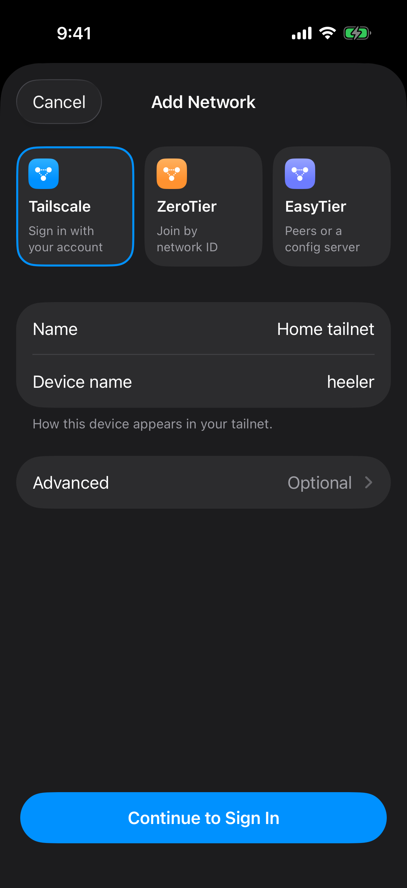

# Connect Heeler through Tailscale

Heeler joins your tailnet by itself, so the phone needs no Tailscale app or VPN.

## Before you start

- You need a Heeler version with **Settings > Overlay Networks**.
- You need a Tailscale account that can add devices.
- To keep the Mac free of a VPN, use [Tailscale without a VPN on the Mac (advanced)](tailscale-userspace.md) instead.

## 1. Prepare the Mac

Complete [Prepare the Host](overlay-networks.md#prepare-the-host). You don't need Tailscale SSH.

## 2. Install Tailscale on the Mac

1. Download the **Standalone** app from [Install Tailscale on macOS](https://tailscale.com/docs/install/mac) and open it.
2. Allow the VPN configuration when asked. On macOS 15 and later, also turn on **Tailscale Network Extension** in **System Settings > General > Login Items & Extensions > Network Extensions**. For older macOS, see [Tailscale's extension steps](https://tailscale.com/docs/concepts/macos-sysext).
3. Sign in from the menu bar icon, and approve the Mac if your tailnet asks.
4. Note the Mac's Tailscale IP on the admin console's [Machines](https://login.tailscale.com/admin/machines) page.

## 3. Join the same tailnet from Heeler

1. Go to **Settings > Overlay Networks > Add Network** and choose **Tailscale**.
2. Fill in the form:

   | Field | Value |
   | --- | --- |
   | Name | Any label, such as `Home tailnet` |
   | Device name | How Heeler appears in the tailnet (default `heeler`) |
   | Advanced | Leave blank to sign in with the browser |

   

3. Tap **Continue to Sign In** and sign in with the same account as the Mac.
4. Return to Heeler. It connects on its own and the network shows **Connected**.

If you see **Waiting for approval**, tap **Open Admin Console** and approve Heeler. If you left the browser early, tap **Sign In with Browser**.

To skip the browser, enter an auth key under **Advanced**, or tap **Use an Auth Key Instead** on the network's screen. For Headscale, enter its HTTPS URL as the **Coordination server**.

If you've changed your tailnet's access rules, make sure Heeler can reach the Mac on port 22.

## 4. Add the Mac as a Host

Add the Host with these values (details in [Connect from Heeler](overlay-networks.md#connect-from-heeler)):

1. Under **Network**, select your Tailscale network.
2. Tap **Choose from Tailnet…**, keep **Fill In** on **IP Address**, and tap the Mac. (Or tap **Add** beside the Mac on the network's screen.)
3. Use port `22`, your Mac username, and the sign-in method you picked. Leave **Jump Host** blank.
4. Save, and trust the fingerprint only if it matches the Mac's.

## 5. Check that it works

Complete [Verify the connection](overlay-networks.md#verify-the-connection), including a test over cellular. Keep the Mac awake and signed in to Tailscale.

## Troubleshooting

| Problem | Try this |
| --- | --- |
| The Mac isn't in **Choose from Tailnet…** | Check that both are in the same tailnet and approved, or type the Mac's Tailscale IP into **Address**. |
| SSH times out | Check that the Mac is awake and online, and your access rules allow port 22. |
| SSH sign-in fails | Use the Mac account's key or password, not your Tailscale login. |
| SSH works but herdr checks fail | Recheck herdr in [Prepare the Host](overlay-networks.md#prepare-the-host). |
| **Not signed in** or **Signed out** | Tap **Sign In** on the network's row, or open the network and tap **Sign In with Browser**. |

## Sign out or remove Heeler

**Sign Out**, in the network screen's **…** menu, signs out only Heeler, never the Mac. Its Hosts stay disconnected until you sign in again.

To remove Heeler's access, delete its device on the admin console's **Machines** page, and revoke any auth key you used on the **Keys** page.

Checked against Tailscale's documentation on 2026-10-09.

Maintainers: see the [guide maintenance record](../agents/overlay-network-guides.md).
